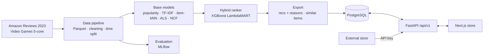

# CartSense

**A video game store with a built-in, explainable recommendation engine.**

CartSense is a full-stack e-commerce application (Next.js + FastAPI) whose
recommendations come from a machine-learning pipeline trained on
**814,533 real Amazon reviews**. Every recommendation answers "Why this?",
and every one the store shows is logged, so each model version can be compared
by real click-through.


---

## Highlights

- **Two-stage hybrid recommender.** ALS, item-kNN, TF-IDF and popularity
  each retrieve candidates; an **XGBoost LambdaMART** ranker re-orders them
  with 24 features.
- **+39% NDCG@10** over the best single model on a held-out future time
  period (0.0182 vs 0.0131). Results are reported as measured, including
  that NCF did **not** beat ALS.
- **Leakage-free evaluation.** Global time-based split, a catalogue that only
  contains products released before each cutoff, and ranker labels taken from
  inside the training history.
- **Explainable.** Each recommendation carries structured reasons, e.g.
  *"Similar to 'Metroid Fusion' (shared: samus, metroid prime)"* or
  *"People who reviewed X also reviewed this"*.
- **Cold start handled.** Guests see what is trending; a new user gets
  personal recommendations after viewing a single product.
- **Production-style serving.** Batch-precomputed recommendations, a
  lightweight API with no ML runtime, impression and click logging, and CTR
  per model version on an analytics dashboard.
- **Reusable REST API.** Versioned (`/api/v1`) and validated, with an
  API-key endpoint for external stores.

## Screenshots

| Recommended for you + "Why this?" | Product page | Analytics dashboard |
|---|---|---|
| _add `docs/screenshots/home.png`_ | _add `docs/screenshots/product.png`_ | _add `docs/screenshots/dashboard.png`_ |

## Results

Offline evaluation on the **test period (2021-07 → 2023-09)**: 25,013 users
ranked against the full catalogue of 23,238 products available at the cutoff.

| Model | NDCG@10 | Recall@10 | MAP@10 | Coverage@10 |
|---|---:|---:|---:|---:|
| **Hybrid (candidates + XGBoost ranker)** | **0.0182** | **0.0287** | **0.0101** | 0.0874 |
| ALS + popularity prior | 0.0131 | 0.0211 | 0.0066 | 0.0751 |
| TF-IDF content + popularity prior | 0.0123 | 0.0219 | 0.0056 | 0.1252 |
| Platform-aware popularity | 0.0124 | 0.0186 | 0.0069 | 0.0085 |
| Recent popularity | 0.0114 | 0.0207 | 0.0049 | 0.0008 |
| NCF (NeuMF) + popularity prior | 0.0111 | 0.0175 | 0.0055 | 0.0499 |
| Random | 0.0002 | 0.0003 | 0.0001 | 1.0000 |

All hyperparameters were chosen on the validation period; the test period was
run once. Absolute values are low because every model ranks the full
catalogue rather than one positive against sampled negatives. Full tables,
the tuning record and the analysis are in
[docs/evaluation.md](docs/evaluation.md).

## Architecture



Recommendation strategies, in order: **precomputed** hybrid output for known
users → **session similarity** for new users (similar products to what they
viewed) → **popularity** for guests. Details and design tradeoffs:
[docs/architecture.md](docs/architecture.md).

## Tech stack

| Layer | Tools |
|---|---|
| Machine learning | Python, pandas, PyArrow, scikit-learn (TF-IDF), implicit (ALS), PyTorch (NCF), XGBoost (LambdaMART), MLflow |
| Backend | FastAPI, SQLAlchemy 2, Pydantic, PostgreSQL / SQLite, JWT, bcrypt |
| Frontend | Next.js 14, TypeScript, Tailwind CSS, Recharts |
| Quality and ops | pytest, Vitest, Testing Library, GitHub Actions, Docker, docker-compose |

## Project structure

```
cartsense/
├── ml/                     # Python package cartsense_ml
│   ├── cartsense_ml/
│   │   ├── data/           # download, Parquet conversion, cleaning, stats, time split, dataset encoding
│   │   ├── models/         # popularity, content, collaborative, ncf, hybrid, registry
│   │   ├── eval/           # ranking metrics, evaluation harness
│   │   ├── experiments/    # config-driven runner + comparison tables
│   │   ├── explain.py      # "Why this?" reasons
│   │   └── export.py       # production training + export for the API
│   ├── configs/            # YAML experiment configs (data, baselines, tuning, final models)
│   └── tests/
├── services/api/           # FastAPI app, routers, data loader, tests
├── apps/web/               # Next.js storefront and dashboard
├── docs/                   # architecture, data pipeline, evaluation, deployment
├── reports/                # generated dataset stats and evaluation results
└── docker-compose.yml
```

## Getting started

**Prerequisites:** Python 3.10+, Node.js 20+. Docker is optional, for the
PostgreSQL stack.

```bash
# 1. Python environment
python -m venv .venv
.venv/Scripts/activate                    # Windows; use .venv/bin/activate on macOS/Linux
pip install -e "ml[dev]" -e "services/api[dev]"

# 2. Data and model (downloads the dataset from its official source)
python -m cartsense_ml.data.pipeline                      # about 1 minute
python -m cartsense_ml.export --out artifacts/export      # about 30 minutes on a laptop CPU

# 3. API (SQLite by default)
cd services/api
python -m app.load_data --export-dir ../../artifacts/export --results-dir ../../reports/results/test
uvicorn app.main:app --port 8000          # interactive docs: http://localhost:8000/docs

# 4. Store (new terminal)
cd apps/web
npm install
npm run dev                               # http://localhost:3000
```

On the sign-in page, choose a **demo shopper** (a real, anonymised dataset
user) to see personal recommendations, or create an account and browse a few
products to see the cold-start path.

To reproduce the evaluation:

```bash
python -m cartsense_ml.experiments.run --config ml/configs/baselines.yaml --stage test
python -m cartsense_ml.experiments.run --config ml/configs/p3_models.yaml --stage test
python -m cartsense_ml.experiments.run --config ml/configs/p4_models.yaml --stage test
mlflow ui --backend-store-uri sqlite:///mlruns.db
```

## API overview

Interactive documentation is served at `/docs`. Main endpoints (prefix `/api/v1`):

| Method | Endpoint | Purpose |
|---|---|---|
| GET | `/products?q=&platform=&sort=&page=` | Browse and search the catalogue |
| GET | `/products/{id}` · `/products/{id}/similar` | Product details and similar products |
| POST | `/auth/register` · `/auth/login` · `/auth/demo` | Accounts and demo personas (JWT) |
| GET | `/recommendations?k=&surface=` | Personal recommendations with reasons and impression ids |
| POST | `/events` | Log views, clicks, searches, add-to-cart |
| GET/POST/DELETE | `/me/wishlist` | Wishlist |
| GET | `/analytics/overview` | Store activity, CTR per model version, offline metrics |
| GET | `/partner/recommendations/{user_id}` | For external stores, authenticated with `X-API-Key` |

Errors use one format: `{"error": {"code": 404, "message": "..."}}`.

## Testing

```bash
cd ml && pytest                  # 93 tests: data pipeline, metrics, models, hybrid, experiments
cd services/api && pytest        # 13 tests: endpoints, auth, cold start, CTR tracking, loader
cd apps/web && npm test          # component tests
```

All three suites run in GitHub Actions on every push.

## Deployment

The store deploys to **Vercel** and the API and PostgreSQL to **Render** (or
Railway). The step-by-step guide, including loading data into a hosted
database, is in [docs/deployment.md](docs/deployment.md). Local PostgreSQL:
`docker compose up --build`.

## Data and attribution

CartSense uses the Amazon Reviews 2023 dataset from the McAuley Lab, UC San Diego:

> Yupeng Hou, Jiacheng Li, Zhankui He, An Yan, Xiusi Chen, Julian McAuley.
> *Bridging Language and Items for Retrieval and Recommendation.*
> arXiv:2403.03952, 2024.

- **Use:** the dataset is used for non-commercial, educational purposes.
- **Not redistributed:** this repository does not contain the dataset. It is
  downloaded from the official source, and raw and processed files are
  git-ignored. Committed reports contain only aggregate statistics.
- **Images:** product images are hosted by Amazon and are **not shown** unless
  `CARTSENSE_SHOW_PRODUCT_IMAGES=true`.
- **Users and brands:** user IDs are anonymised by the dataset authors.
  Product names and brands belong to their respective owners.
- **No synthetic data:** clicks, views and wishlists do not exist in the
  dataset. The store records real ones only (`is_synthetic = false`).
  Synthetic data is never used for training or metrics.

## Known limitations and next steps

- **Retraining from store events** is designed but not automated yet. Events
  and impressions are logged, but no script merges them into the next
  training run.
- **Model versions** are tracked in MLflow runs and in the database, but not
  registered in the MLflow Model Registry.
- **Database:** the tests run on SQLite. PostgreSQL is supported through
  `DATABASE_URL` but has not been tested in CI. The schema is created on
  startup; there are no migrations yet.
- **Docker:** the Docker setup has not been run end to end yet.
- **Retrieval is the bottleneck:** only about 18% of the products users went
  on to review are among their candidates. Better retrieval would help more
  than a better ranker.
- **Speed:** full-catalogue top-k selection takes 15–84 s per offline
  evaluation run and could be made faster.

## License

Code: [MIT](LICENSE). The dataset is subject to its own terms and is not
included.
