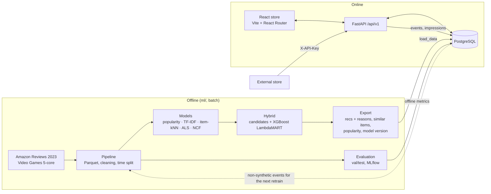

# Architecture

## Request path for "Recommended for you"

1. The store calls `GET /api/v1/recommendations` with the user's token.
2. The API chooses a strategy:
   * **precomputed:** the active model version's batch output, for demo
     shoppers and store accounts the model was trained on;
   * **session_similarity:** for new accounts and guests (identified by the
     `X-Session-Id` browser session), products similar to what they viewed,
     clicked, added to the bag or wishlisted. A guest who signs up keeps that
     session history;
   * **popular:** recent popularity, for visitors with no signal, and for the
     control group while an A/B test is running.
3. Each returned item is logged as an impression (model version, position,
   session, A/B variant). A click event carries the impression id, so
   click-through rate is measured per model version and per variant.
4. `scripts/retrain.py` turns real store events into interactions, retrains
   on dataset + store activity, and activates the new version.

## Design decisions

| Decision | Why | Tradeoff |
|---|---|---|
| Batch-precomputed recommendations | The API needs no ML runtime (no PyTorch or XGBoost), so it fits a free-tier instance and answers from indexed tables | Recommendations for known users are only as fresh as the last export |
| Online fallback from similar items | New accounts and guests get personal results after a single product view, without retraining | Content similarity only. Collaborative signal arrives at the next retrain |
| A/B assignment by hashing the visitor | Stable variant per visitor with no extra table; works for guests | Changing the experiment name reshuffles everyone |
| Store events placed at the end of the dataset timeline when retraining | Recency weighting sees them as newest without a few clicks outweighing 2023 data | The real time gap between dataset and store is not modelled |
| Global time split, cutoff-aware catalogue | No future information in training or features | Lower absolute metrics than leave-one-out papers |
| Hybrid ranker trained on a label window inside the history | The ranker learns from data its candidate models never saw, as in production | Two rounds of candidate-model training per fit |
| SQLite for development and tests, PostgreSQL in production | Tests run anywhere with no services; the same SQLAlchemy models are used | No Postgres-only features (e.g. full-text search). Search uses `ILIKE` |
| Product images off by default | Images are hosted by Amazon and copyrighted; a public demo should not hot-link them | Placeholder tiles instead of box art |
| Synthetic events flagged and excluded | Analytics and training must reflect real behaviour only | None. The site writes only real events |
